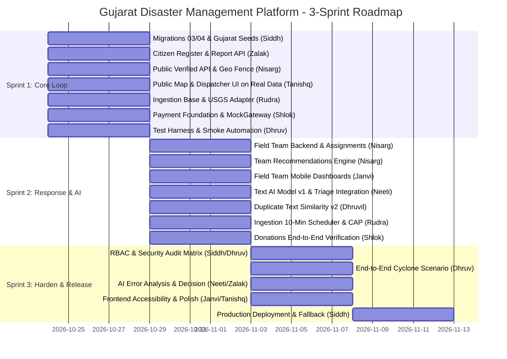

# Gujarat Disaster Management Platform (DRCH)

Disaster Response Coordination Hub — an operational incident coordination
platform built for the State of Gujarat. The system connects three groups of
users: citizens who report emergencies, disaster management staff who triage
and dispatch resources, and field teams who receive assignments and report
progress in the field.

---

## What is real (verified in code)

The following capabilities are implemented end-to-end and covered by
automated tests in `backend/tests/`.

**Staff authentication with mandatory two-factor login.**
Staff accounts require an Argon2id password followed by a TOTP code
(RFC 6238, 30-second window). The MFA challenge is a short-lived,
purpose-bound JWT. A failed code or expired challenge does not issue an
access token. Login failures are counted; after five consecutive failures
the account is locked and all existing tokens are revoked by incrementing
`token_version`. (`backend/app/routers/auth.py`, `backend/app/security.py`)

**Incident verification workflow.**
A dispatcher can move an incident through the states SUBMITTED,
NEEDS_INFORMATION, VERIFIED, REJECTED, DISPATCHED, RESOLVED, and CLOSED.
Each transition is validated by a strict state machine, recorded in
`incident_status_history`, written to the audit log, and triggers a
notification to the reporting citizen. A VERIFIED decision requires a
priority level (CRITICAL, HIGH, MEDIUM, or LOW) and a rationale.
(`backend/app/routers/dm/incidents.py`)

**Resource dispatch with row-level locking.**
When a dispatcher creates a dispatch order, each requested resource row is
locked with `SELECT ... FOR UPDATE` before the available quantity is
decremented. Concurrent requests for the same resource that would
over-allocate are refused with a 409 RESOURCE_CONFLICT response and no
partial state is written. Resources are released automatically when a
dispatch order is rejected or completed.
(`backend/app/services/resources.py`, `backend/app/services/dispatch.py`)

**Append-only, hash-chained audit log.**
Every state change, login event, access denial, and dispatch action writes
a row to `audit_logs`. A PostgreSQL trigger (`fn_audit_log_hash_chain`)
computes a SHA-256 hash of each new row concatenated with the previous
row's hash, storing it in `row_hash`. Database-level triggers also block
UPDATE and DELETE on the table. The CI pipeline verifies the hash chain
on every pull request. (`backend/db/migrations/01_schema.sql`, lines 602-629)

**Gujarat boundary enforcement.**
Incident coordinates are validated against Gujarat state boundaries via
PostGIS spatial queries, with automatic fallback to the Google Maps
Geocoding API (if `GOOGLE_MAPS_API_KEY` is configured) and then to
OpenStreetMap Nominatim (free, no key required). Resolved districts are
cached in the `administrative_boundaries` table.
(`backend/app/geo.py`)

**Advisory AI triage.**
`POST /api/v1/dm/incidents/{id}/ai-triage` sends a PII-scrubbed copy of the report to the
rules-based triage service in `ai-workers/` (`AI_TRIAGE_URL`, optional `AI_TRIAGE_TOKEN`) and stores
the validated suggestion separately. Output is advisory only and is never applied to an incident
automatically; a dispatcher makes the final decision. Without `AI_TRIAGE_URL` the result is
`UNAVAILABLE` and staff triage manually. (`backend/app/services/ai_provider.py`,
`backend/app/routers/dm/ai.py`, `ai-workers/rules.py`)

---

## What is simulated

**Demo seed data (development only).**
`backend/db/seeds/demo/` (sample field teams, sample campaigns and four incidents flagged
`is_simulated = TRUE`) is applied only when `APP_ENV=development`. Staging and production receive
only `backend/db/seeds/reference/` (roles, agencies, system accounts, safety content). The public API
hides simulated incidents outside development.

**Mock payment gateway (SANDBOX).**
Donations use `MockGateway` (HMAC-signed sandbox, `PAYMENT_GATEWAY=mock`). There is no live
gateway integration; receipts are issued only after a valid signature is verified.

**Fallback fixtures for external alerts.**
No ingestion adapters are installed yet: `POST /api/v1/internal/ingest/run` answers
`NOT_IMPLEMENTED` and stores nothing. `GET /api/v1/public/alerts` returns whatever is in
`external_alerts` (rows flagged `is_fallback` must be labelled in the UI).

**Synthetic or replayed social data.**
Social distress signals and external disaster feeds are not ingested live;
any social feed data displayed in the interface is synthetic or replayed.

---

## Staging and cold-start

- Backend API (Render): Configured via `STAGING_URL` or Render web service `https://drch-backend.onrender.com`
- Frontend (Vercel Preview): Deployment preview URL generated via Vercel integration

The backend runs on Render's free tier. Free tier services sleep after a
period of inactivity. The first request after an idle period may take 45 to
90 seconds while the container wakes up, initializes database connection pools,
and completes background worker checks. Cold-start polling and smoke scripts
should use a 90-second timeout.

Health check endpoints:
- Liveness probe: `GET /health` returns `{"status": "healthy", "service": "drch-backend"}`
- Database reachability: `GET /api/v1/health` returns `{"status": "healthy", "service": "drch-backend", "database": "ok"}` when PostGIS is connected, or `"unavailable"` / `"not_configured"` otherwise.

---

## 👥 Team Roster & Ownership Matrix

| Member | Group | Role in Project | Key Module Ownership |
| :--- | :--- | :--- | :--- |
| **Siddh** | **Leader** | Tech Lead & Integration Owner | CI/CD, database migrations (01-04), secrets management, merge gatekeeper, repo hygiene. |
| **Zalak** | Frontend & Backend | Citizen & Public Backend Lead | Citizen auth/register API, incident reporting, timeline, LLM adapter, AI-vs-human analytics. |
| **Nisarg** | Frontend & Backend | Dispatch & Field Backend Lead | Field team role & assignments API, Gujarat geofencing (`geo.py`), team recommendation engine. |
| **Shlok** | Frontend & Backend | Payments & Dispatch Refactor | Payment gateway interface & MockGateway, donation APIs, signal promotion, state transitions. |
| **Rudra** | ML | Ingestion & External Feeds | Official alert adapters (USGS, SACHET CAP), ingestion runs scheduler, AI service skeleton. |
| **Neeti** | ML (GenAI) | AI Lead | Dataset design, text classification models, evaluation harness, AI triage integration & guardrails. |
| **Dhruvil** | ML | Computer Vision & Similarity | Image classification reproduction, duplicate text-similarity model, in-process model provider. |
| **Janvi** | Frontend & Backend | Frontend Lead (Citizen & Field) | Citizen report forms, My Reports timeline, Field responder dashboards, alerts map layer. |
| **Tanishq** | Frontend & Backend | Frontend Lead (Public & Dispatch)| Public Gujarat interactive map, Dispatcher workspace console, recommendations UI. |
| **Dhruv** | Frontend & Backend | QA & Test Lead | DB test fixtures, smoke test suite (`scripts/smoke.py`), ran-and-skipped guard, scenario tests. |

---

## 📅 3-Sprint Implementation Plan



---

## 📋 Sprint Roadmap & Archived Work Allocation

The active implementation plan follows the **3-Sprint Production Delivery Roadmap** shown in the Gantt chart above.

The original 5-phase theoretical concept allocation (Kafka, drone edge CV, Indic-BERT, 10-member allocation) has been archived for reference in [`docs/archive/original-roadmap.md`](docs/archive/original-roadmap.md).

---

## 🛠️ Technology Stack Recommendations

| Tier | Technologies |
| :--- | :--- |
| **Frontend & PWA** | Next.js / React 18, Leaflet / Mapbox GL JS, TailwindCSS, Service Workers, IndexedDB |
| **Backend & APIs** | Node.js (TypeScript) / Python (FastAPI), RESTful API, WebSocket (Socket.io) |
| **Database & GIS** | PostgreSQL 16 with **PostGIS 3.4**, Redis (Caching & Pub/Sub), Uber H3 Spatial Index |
| **AI / Machine Learning** | Multilingual Indic-LLM / Llama-3 (vLLM / Ollama), YOLOv8/v9 (PyTorch/ONNX), LangChain |
| **Data Ingestion** | Apache Kafka / RabbitMQ, XML-to-JSON CAP Parser, Webhook Adapters |
| **DevOps & Infra** | Docker, Kubernetes, Nginx / Traefik, GitHub Actions CI/CD, Prometheus & Grafana |
| **Compliance & Security** | OAuth 2.0 / JWT, MeitY-empaneled Cloud (AWS Mumbai / Azure India), DPDP PII Sanitizer |

---

## 🚀 Quick Start Guide (Local Development Setup)

### Prerequisites
- [Docker & Docker Compose](https://www.docker.com/) installed
- [Node.js (v18+)](https://nodejs.org/) & [Python (v3.10+)](https://python.org/)
- Git

### 1. Clone the Repository
```bash
git clone https://github.com/Siddhcreator-1706/IT314_Software_Project.git
cd IT314_Software_Project
```

### 2. Configure Environment Variables
```bash
cp .env.example .env
# Edit .env with your LLM API keys, DB credentials, and mock ports
```

### 3. Database Initialization (Migrations & Seed Data)
When setting up locally or connecting to a remote PostgreSQL/Neon database, apply the schema migration and baseline seed data:

```bash
# Using the automated migration runner (applies all migrations & seeds in order, skipping already run):
cd backend && python -m app.migrate

# Or manually applying via psql:
for f in $(find backend/db/migrations -name '*.sql' | sort -V); do psql "$DATABASE_URL" -f "$f"; done
for s in $(find backend/db/seeds -name '*.sql' | sort -V); do psql "$DATABASE_URL" -f "$s"; done
```
*Note: the backend applies pending migrations (and reference seeds) itself on startup; it refuses to start outside `APP_ENV=development` if required settings are missing.*

### 4. Running the Applications

#### Option A: Local Development (without Docker)
Run the backend and frontend in separate terminals:

```bash
# Terminal 1 - FastAPI Backend (runs migrations and starts API server on :8000)
cd backend
uvicorn main:app --reload --port 8000

# Terminal 2 - Next.js Frontend (starts web client on :3000)
cd frontend
npm run dev
```

#### Option B: Containerized Platform (Docker Compose)
Since the project is containerized, you can launch the Next.js frontend, FastAPI backend, Python AI workers, and the local PostgreSQL/PostGIS database with a single command:

```bash
docker compose up --build
```

### 5. Access the Applications & Health Endpoints
Once the services are running, access:
- **Frontend (Web Client & Tactical Portals):** `http://localhost:3000`
- **Backend API Docs (Swagger UI):** `http://localhost:8000/docs`
- **System Health Diagnostics:**
  - Liveness: `http://localhost:8000/health`
  - Readiness (database): `http://localhost:8000/api/v1/health`

---

## 🌐 Production Deployment Architecture

The platform supports both multi-cloud serverless deployment and fully containerized production orchestration:

### Option A: Cloud / Managed Services (Recommended)
- **Frontend:** Hosted on **Vercel** (`frontend/`) with change-detection filtering via `vercel.json` and `vercel-ignored-build.sh`.
- **Backend API:** Hosted on **Render** using `render.yaml` with auto-deployments, containerized runtime, and health check probes at `/health`.
- **Database:** Hosted on **Neon Serverless PostgreSQL** with PostGIS enabled.

### Option B: Self-Hosted Production Docker Compose
To deploy the full stack against external cloud databases/queues using production containers:

```bash
docker compose -f docker-compose.prod.yml up --build -d
```

### 🔄 CI/CD Automation & Security Gates
The repository separates verification (CI) from publication & deployment (CD):
1. **Continuous Integration ([`.github/workflows/ci.yml`](.github/workflows/ci.yml))**:
   - Triggers on every **Pull Request** targeting `main`.
   - **Frontend Check:** Node.js 20 & ESLint.
   - **Python Check:** Ruff linter + Bandit static security analysis (SAST).
   - **Database Integrity:** PostgreSQL 16 + PostGIS schema validation and cryptographic audit chain hash verification.
   - **Backend Tests:** Pytest unit test execution.
   - **Container Validation:** Fast Docker build verification and **Aqua Security Trivy** vulnerability scan.
   - **Quality Gate:** `ci-gatekeeper` blocks PR merge if any check fails.
2. **Continuous Deployment ([`.github/workflows/cd.yml`](.github/workflows/cd.yml))**:
   - Triggers on **Push / Merge to `main`**.
   - Builds production container images with tags (`latest`, `sha-*`) and pushes them to **GitHub Container Registry (GHCR)**.
   - Verifies deployment readiness against production manifests (`docker-compose.prod.yml`).

---

## 🤝 Contributing to DRCH

We welcome contributions from all 10 team members! To keep our codebase clean and organized, please follow these guidelines:

1. **How to Decide What to Work On:**
   - Cross-reference the **Team Roster** and **Sprint Roadmap** above.
   - Find an unassigned GitHub Issue matching your phase/role and assign it to yourself.
2. **Branching Strategy:**
   - Never commit directly to `main`. 
   - Create a new branch: `feature/<module>-<description>` (e.g., `feature/medic-dashboard`) or `bugfix/<description>`.
3. **Commit Messages:**
   - Follow [Conventional Commits](https://www.conventionalcommits.org/en/v1.0.0/) format (e.g., `feat(frontend): add map pins`, `fix(backend): resolve db crash`).
4. **Submitting a Pull Request (PR):**
   - Push your branch, open a PR against `main`, and link the Issue it resolves.
   - Request a code review from the Team Lead or a peer. Once approved and CI passes, it will be merged.

---

## 🔒 Compliance & Standards

- **NDMA / IRS Guidelines**: Incident categorization, resource management, and command chain mapping.
- **DPDP Act 2023**: Strict data minimization, on-the-fly PII scrubbing, and right-to-forget compliance for citizen distress data.
- **C-DAC ERSS 112 Norms**: Encrypted transport, RBAC audit trails, and strict data isolation for telecom metadata.
- **MeitY Guidelines**: Strict hosting within certified sovereign data centers on Indian soil.

---

## 📜 License

This project is licensed under the **Apache License 2.0** - see the `LICENSE` file for details.
