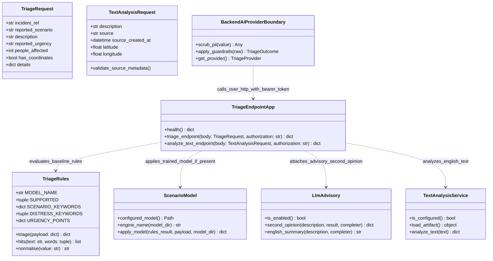

# DRCH Class Diagrams & Architecture Models

This document specifies the structural software architecture of the Disaster Response Coordination Hub (DRCH) for the State of Gujarat. The diagrams reflect the actual implementation across the FastAPI backend, PostgreSQL/PostGIS database schemas, domain service layer, and the advisory AI triage workers.

### Source files used
- [common.py](file:///c:/Users/Dhruv/.gemini/antigravity-ide/scratch/IT314_Software_Project/backend/app/common.py) - Shared enumerations and system types
- [01_schema.sql](file:///c:/Users/Dhruv/.gemini/antigravity-ide/scratch/IT314_Software_Project/backend/db/migrations/01_schema.sql) - Core PostgreSQL relational tables, PostGIS geometries, and hash-chain audit triggers
- [02_dm_module.sql](file:///c:/Users/Dhruv/.gemini/antigravity-ide/scratch/IT314_Software_Project/backend/db/migrations/02_dm_module.sql) - Staff permissions and incident status tracking tables
- [03_core_extensions.sql](file:///c:/Users/Dhruv/.gemini/antigravity-ide/scratch/IT314_Software_Project/backend/db/migrations/03_core_extensions.sql) - Ingestion runs, source signals, and field team extensions
- [09_account_invitations_and_passwords.sql](file:///c:/Users/Dhruv/.gemini/antigravity-ide/scratch/IT314_Software_Project/backend/db/migrations/09_account_invitations_and_passwords.sql) - Account invitations, token hashes, and password reset expirations
- [10_signal_matching.sql](file:///c:/Users/Dhruv/.gemini/antigravity-ide/scratch/IT314_Software_Project/backend/db/migrations/10_signal_matching.sql) - Signal spatial synchronization trigger and pending indexes
- [11_evidence_blobs.sql](file:///c:/Users/Dhruv/.gemini/antigravity-ide/scratch/IT314_Software_Project/backend/db/migrations/11_evidence_blobs.sql) - Citizen photo binary content persistence
- [12_payment_webhook_events.sql](file:///c:/Users/Dhruv/.gemini/antigravity-ide/scratch/IT314_Software_Project/backend/db/migrations/12_payment_webhook_events.sql) - Payment webhook idempotency event ledger
- [15_refresh_tokens.sql](file:///c:/Users/Dhruv/.gemini/antigravity-ide/scratch/IT314_Software_Project/backend/db/migrations/15_refresh_tokens.sql) - Rotating refresh token session limits and revocation tracking
- [16_shelters.sql](file:///c:/Users/Dhruv/.gemini/antigravity-ide/scratch/IT314_Software_Project/backend/db/migrations/16_shelters.sql) - Relief shelters and medical posts capacity management
- [17_incident_notes.sql](file:///c:/Users/Dhruv/.gemini/antigravity-ide/scratch/IT314_Software_Project/backend/db/migrations/17_incident_notes.sql) - Internal incident notes schema for shift handovers
- [19_drop_unused_schema.sql](file:///c:/Users/Dhruv/.gemini/antigravity-ide/scratch/IT314_Software_Project/backend/db/migrations/19_drop_unused_schema.sql) - Clean schema removal of unused legacy views and configurations
- [citizen.py](file:///c:/Users/Dhruv/.gemini/antigravity-ide/scratch/IT314_Software_Project/backend/app/schemas/citizen.py) - Pydantic models for citizen incident reporting and timeline
- [field.py](file:///c:/Users/Dhruv/.gemini/antigravity-ide/scratch/IT314_Software_Project/backend/app/schemas/field.py) - Pydantic models for responder missions, progress milestones, and backup requests
- [recommendations.py](file:///c:/Users/Dhruv/.gemini/antigravity-ide/scratch/IT314_Software_Project/backend/app/schemas/recommendations.py) - Schemas for team capability ranking
- [incidents.py](file:///c:/Users/Dhruv/.gemini/antigravity-ide/scratch/IT314_Software_Project/backend/app/services/incidents.py) - Incident lifecycle validation, version locking, and history logging
- [dispatch.py](file:///c:/Users/Dhruv/.gemini/antigravity-ide/scratch/IT314_Software_Project/backend/app/services/dispatch.py) - Dispatch state transitions, progress tracking, and automated escalation
- [resources.py](file:///c:/Users/Dhruv/.gemini/antigravity-ide/scratch/IT314_Software_Project/backend/app/services/resources.py) - Row-level locking (`SELECT ... FOR UPDATE`) resource reservation and release
- [recommendations.py](file:///c:/Users/Dhruv/.gemini/antigravity-ide/scratch/IT314_Software_Project/backend/app/services/recommendations.py) - PostGIS spatial distance scoring and capability matching
- [signal_matching.py](file:///c:/Users/Dhruv/.gemini/antigravity-ide/scratch/IT314_Software_Project/backend/app/services/signal_matching.py) - Advisory spatiotemporal signal clustering and Jaccard text similarity
- [duplicate_similarity.py](file:///c:/Users/Dhruv/.gemini/antigravity-ide/scratch/IT314_Software_Project/backend/app/services/duplicate_similarity.py) - Character trigram cosine similarity for incident deduplication
- [ai_provider.py](file:///c:/Users/Dhruv/.gemini/antigravity-ide/scratch/IT314_Software_Project/backend/app/services/ai_provider.py) - AI triage boundary, PII scrub, and guardrail validation
- [ingestion.py](file:///c:/Users/Dhruv/.gemini/antigravity-ide/scratch/IT314_Software_Project/backend/app/services/ingestion.py) - Feed polling engine, advisory lock management, and external signal ingestion
- [audit.py](file:///c:/Users/Dhruv/.gemini/antigravity-ide/scratch/IT314_Software_Project/backend/app/audit.py) - Append-only SHA-256 hash-chained event logger
- [auth.py](file:///c:/Users/Dhruv/.gemini/antigravity-ide/scratch/IT314_Software_Project/backend/app/auth.py) - Security principal dependencies and staff role enforcement
- [geo.py](file:///c:/Users/Dhruv/.gemini/antigravity-ide/scratch/IT314_Software_Project/backend/app/geo.py) - Gujarat boundary validation and PostGIS containment
- [triage_service.py](file:///c:/Users/Dhruv/.gemini/antigravity-ide/scratch/IT314_Software_Project/ai-workers/triage_service.py) - Advisory AI FastAPI microservice
- [rules.py](file:///c:/Users/Dhruv/.gemini/antigravity-ide/scratch/IT314_Software_Project/ai-workers/rules.py) - Deterministic keyword and points triage rule engine
- [scenario_model.py](file:///c:/Users/Dhruv/.gemini/antigravity-ide/scratch/IT314_Software_Project/ai-workers/service/scenario_model.py) - Trained scenario ML model loader and inference
- [llm.py](file:///c:/Users/Dhruv/.gemini/antigravity-ide/scratch/IT314_Software_Project/ai-workers/service/llm.py) - Advisory second-opinion LLM adapter

---

## 1. Domain & Persistence Entities Class Diagram

The following diagram captures the database tables, domain entities, and data relationships in DRCH. It models the core incident record, lifecycle audit trails, resource reservations, field responder assignments, and external ingestion entities.

```mermaid
classDiagram
    class User {
        +UUID user_id
        +UUID role_id
        +str email
        +str full_name
        +str phone
        +str status
        +datetime created_at
        +datetime updated_at
    }

    class UserAuth {
        +UUID user_id
        +str password_hash
        +bool mfa_enabled
        +str mfa_secret
        +int failed_login_count
        +datetime locked_until
        +int token_version
        +datetime last_login_at
        +str invitation_token_hash
        +datetime invitation_expires_at
        +str password_reset_token_hash
        +datetime password_reset_expires_at
    }

    class RefreshToken {
        +UUID refresh_token_id
        +UUID user_id
        +UUID family_id
        +str token_hash
        +int token_version
        +bool mfa_verified
        +datetime created_at
        +datetime idle_expires_at
        +datetime absolute_expires_at
        +datetime revoked_at
        +str revoked_reason
    }

    class Role {
        +UUID role_id
        +str code
        +str name
        +str description
    }

    class StaffPermission {
        +UUID user_id
        +str permission
        +UUID granted_by
        +datetime granted_at
    }

    class Agency {
        +UUID agency_id
        +str code
        +str name
        +str agency_type
        +str contact_phone
        +bool is_active
        +datetime created_at
        +datetime updated_at
    }

    class Shelter {
        +UUID shelter_id
        +str name
        +str type
        +str address_text
        +str district
        +float latitude
        +float longitude
        +int total_capacity
        +int current_occupancy
        +str contact_number
        +str status
        +str notes
        +bool is_simulated
        +UUID created_by
        +UUID updated_by
        +datetime created_at
        +datetime updated_at
    }

    class Incident {
        +UUID incident_id
        +str incident_ref
        +UUID reporter_id
        +str scenario
        +str status
        +str reported_urgency
        +str verified_priority
        +str priority_rationale
        +UUID verified_by
        +datetime verified_at
        +int people_affected
        +str location_source
        +float latitude
        +float longitude
        +str district
        +str address_text
        +str landmark
        +dict details
        +UUID canonical_incident_id
        +int version
        +datetime submitted_at
        +datetime updated_at
        +datetime closed_at
    }

    class IncidentStatusHistory {
        +UUID history_id
        +UUID incident_id
        +str from_status
        +str to_status
        +UUID changed_by
        +str reason
        +datetime created_at
    }

    class EvidenceFile {
        +UUID evidence_id
        +UUID incident_id
        +UUID uploader_id
        +str file_name
        +str file_path
        +str mime_type
        +int size_bytes
        +str sha256_hash
        +str scan_state
        +datetime uploaded_at
    }

    class EvidenceBlob {
        +UUID evidence_id
        +bytes content
    }

    class IncidentNote {
        +UUID note_id
        +UUID incident_id
        +UUID author_id
        +str body
        +datetime created_at
    }

    class AiRecommendation {
        +UUID recommendation_id
        +UUID incident_id
        +str model_name
        +str suggested_scenario
        +str suggested_priority
        +float confidence
        +str uncertainty_note
        +dict factors
        +str status
        +datetime created_at
    }

    class Resource {
        +UUID resource_id
        +UUID agency_id
        +str name
        +str type
        +str status
        +Decimal total_quantity
        +Decimal quantity_available
        +str unit
        +str district
        +dict capability
        +int version
        +datetime updated_at
    }

    class DispatchOrder {
        +UUID dispatch_id
        +str dispatch_ref
        +UUID incident_id
        +UUID created_by
        +UUID receiving_agency_id
        +str status
        +str priority
        +str instructions
        +str idempotency_key
        +str acknowledged_by
        +datetime acknowledged_at
        +datetime created_at
        +datetime updated_at
    }

    class ResourceAssignment {
        +UUID assignment_id
        +UUID dispatch_id
        +UUID resource_id
        +Decimal quantity
        +UUID assigned_by
        +datetime assigned_at
        +datetime released_at
        +str release_reason
    }

    class DispatchProgress {
        +UUID progress_id
        +UUID dispatch_id
        +str status
        +str note
        +UUID recorded_by
        +datetime recorded_at
    }

    class FieldTeamMember {
        +UUID member_id
        +UUID user_id
        +UUID resource_id
        +str callsign
        +bool is_leader
        +datetime joined_at
    }

    class TeamRequest {
        +UUID request_id
        +UUID dispatch_id
        +UUID requested_by
        +str required_capability
        +str note
        +str status
        +datetime created_at
    }

    class AgencyMessage {
        +UUID message_id
        +UUID sender_id
        +UUID recipient_agency_id
        +UUID incident_id
        +UUID dispatch_id
        +str subject
        +str body
        +str status
        +datetime acknowledged_at
        +datetime created_at
    }

    class SourceSignal {
        +UUID signal_id
        +str source
        +str source_uid
        +str content_text
        +float latitude
        +float longitude
        +str status
        +str ai_label
        +float ai_confidence
        +dict ai_details
        +datetime ai_triage_attempted_at
        +datetime created_at
    }

    class ExternalAlert {
        +UUID alert_id
        +str source
        +str source_uid
        +str event_type
        +str severity
        +str urgency
        +str certainty
        +str area_text
        +float latitude
        +float longitude
        +bool is_fallback
        +datetime effective_at
        +datetime expires_at
        +dict raw_payload
    }

    class PaymentWebhookEvent {
        +str gateway_name
        +str event_id
        +str event_type
        +UUID donation_id
        +str outcome
        +datetime received_at
    }

    class AuditLog {
        +UUID audit_id
        +int sequence_num
        +datetime event_timestamp
        +UUID actor_user_id
        +str action
        +str entity_type
        +UUID entity_id
        +str result
        +str rationale
        +dict before_state
        +dict after_state
        +str ip_address
        +str previous_hash
        +str row_hash
    }

    Role "1" <-- "0..*" User : assigned_to
    User "1" *-- "1" UserAuth : manages_credentials
    User "1" *-- "0..*" RefreshToken : active_sessions
    User "1" *-- "0..*" StaffPermission : holds_permissions
    User "1" <-- "0..*" Incident : reports
    Agency "1" <-- "0..*" Resource : owns
    Incident "1" *-- "0..*" IncidentStatusHistory : tracks_history
    Incident "1" *-- "0..*" EvidenceFile : attaches
    EvidenceFile "1" *-- "1" EvidenceBlob : binary_content
    Incident "1" *-- "0..*" IncidentNote : internal_notes
    Incident "1" *-- "0..*" AiRecommendation : advisory_output
    Incident "1" o-- "0..*" DispatchOrder : initiates
    DispatchOrder "1" *-- "1..*" ResourceAssignment : allocates
    Resource "1" <-- "0..*" ResourceAssignment : allocated_in
    DispatchOrder "1" *-- "0..*" DispatchProgress : logs_milestones
    DispatchOrder "1" *-- "0..*" TeamRequest : requests_reinforcements
    Resource "1" *-- "0..*" FieldTeamMember : staffed_by
    User "1" <-- "1" FieldTeamMember : assigned_profile
    DispatchOrder "0..1" <-- "0..*" AgencyMessage : relays_orders
    Agency "1" <-- "0..*" AgencyMessage : receives_messages
    Incident "0..1" <-- "0..1" Incident : canonical_duplicate_of
    User "0..1" <-- "0..*" Shelter : managed_by
    User "0..1" <-- "0..*" AuditLog : audit_actor
```

This diagram illustrates the core domain model of DRCH. `Incident` serves as the central entity linking citizen reports to advisory `AiRecommendation` outputs, `IncidentStatusHistory` audit trails, `EvidenceFile` media (with byte contents in `EvidenceBlob`), and shift collaboration logs in `IncidentNote`. When emergency assistance is mobilised, an incident spawns `DispatchOrder` records. Each dispatch order locks specific `Resource` items via `ResourceAssignment` using database row-level locking. Field responders belonging to `FieldTeamMember` update operational milestones in `DispatchProgress` (including `EN_ROUTE`, `ON_SCENE`, and `DELAYED`) and request backup units via `TeamRequest`. All authentication records (`UserAuth`), rotating sessions (`RefreshToken`), permissions (`StaffPermission`), public relief facilities (`Shelter`), and administrative actions are cryptographically chained in `AuditLog`.

---

## 2. Backend Application Services Class Diagram

The following diagram defines the primary service classes in the FastAPI backend (`backend/app/services/`, `geo.py`, and `audit.py`), highlighting their business methods, responsibilities, and relationships.

```mermaid
classDiagram
    class IncidentService {
        +lock_incident(conn, incident_id) dict
        +update_incident(conn, principal, row, action, rationale, to_status, fields) dict
        +check_version(row, expected) void
        +ensure_open(row) void
        +reopen_target(previous, verified_priority) str
        +open_dependencies(conn, incident_id) dict
        +require_status(row, allowed, message) void
    }

    class DispatchService {
        +fetch_dispatch(conn, dispatch_id) dict
        +lock_dispatch(conn, dispatch_id, dispatch) dict
        +set_dispatch_status(conn, principal, dispatch, status, action, rationale, after) void
        +record_dispatch_progress(conn, dispatch_id, status, note, recorded_by) UUID
        +apply_acknowledgement(conn, principal, target, acknowledged_by, channel, note) dict
        +apply_rejection(conn, principal, target, reason, reported_by, channel) dict
        +apply_progress(conn, principal, target, event, note, reported_by, channel, latitude, longitude) dict
        +apply_completion(conn, principal, target, confirmed_by, channel, summary, civilians_evacuated, civilians_treated) dict
        +apply_failure(conn, principal, target, reason) dict
        +escalate(conn, principal, dispatch, reason) int
        +escalate_overdue() int
    }

    class ResourceService {
        +derive_status(current, available) str
        +reserve(conn, principal, resource_id, dispatch, quantity) dict
        +release_all_for_dispatch(conn, principal, dispatch_id, reason) list
    }

    class TeamRecommendationEngine {
        +recommend_teams_for_incident(conn, incident_id, limit) list
        +score_team(team, scenario, distance_km) float
    }

    class SignalMatchingEngine {
        +tokenize(text) set
        +text_similarity(text_a, text_b) tuple
        +score_pair(candidate, pending) tuple
        +cluster_signals(conn, min_score) list
    }

    class DuplicateSimilarityEngine {
        +normalise(text) str
        +trigrams(text) Counter
        +text_similarity(a, b) float
        +combined_score(text, distance_m, minutes_apart, same_address, radius_m, window_hours) float
        +explain(score, text) str
        +score_candidates(base_description, candidates, radius_m, window_hours) list
    }

    class IngestionRunner {
        +registered_adapters(settings) list
        +run_ingestion(source_filter) list
        +store_alerts(items) int
        +store_signals(items, settings) int
        +prelabel(text, settings) tuple
        +classify_with_indicbert(text, settings) tuple
        +triage_unprocessed_social_signals(sources, settings) int
    }

    class GeoService {
        +load_boundaries_from_db() bool
        +is_in_gujarat(lat, lon) bool
        +district_for(lat, lon) str
        +validate_coordinates_in_gujarat(lat, lon) dict
        +reverse_geocode_district(lat, lon) str
    }

    class AuditService {
        +record(conn, actor, action, entity_type, entity_id, rationale, before, after, ip, result) UUID
        +verify_audit_log_hash_chain(conn) tuple
    }

    class TriageProvider {
        <<abstract>>
        +str name
        +triage(payload) TriageOutcome*
    }

    class HttpTriageProvider {
        +str url
        +triage(payload) TriageOutcome
    }

    class UnavailableProvider {
        +triage(payload) TriageOutcome
    }

    class SessionService {
        +start_session(conn, account, mfa) tuple
        +rotate(conn, refresh_token, ip) RotationResult
        +revoke(conn, token_id, user_id, reason) bool
        +revoke_all(conn, user_id, reason) int
    }

    TriageProvider <|-- HttpTriageProvider
    TriageProvider <|-- UnavailableProvider
    DispatchService ..> ResourceService : locks_and_releases_resources
    DispatchService ..> AuditService : writes_audit_events
    IncidentService ..> AuditService : writes_audit_events
    ResourceService ..> AuditService : writes_audit_events
    TeamRecommendationEngine ..> GeoService : calculates_distance
    IngestionRunner ..> TriageProvider : obtains_advisory_prelabels
    IngestionRunner ..> GeoService : checks_boundaries
```

This diagram presents the service architecture supporting DRCH's operational core. `DispatchService` handles dispatch transactions, interacting with `ResourceService` to acquire exclusive row locks (`SELECT ... FOR UPDATE`) so emergency equipment and teams are never double-allocated. `IncidentService` governs the incident state machine and optimistic versioning (`check_version`). `GeoService` validates PostGIS spatial containment within Gujarat boundaries. Advisory AI decisions are handled cleanly by `TriageProvider` implementations without direct coupling to model internals, while `AuditService` ensures every state transition is recorded in the immutable SHA-256 hash chain.

---

## 3. AI Workers & Inference Architecture Class Diagram

The following diagram captures the microservice architecture of the advisory AI worker (`ai-workers/`), detailing the request schemas, rule-based triage, scenario inference, and optional advisory LLM integration.

This diagram shows the AI triage service architecture. The backend calls `TriageEndpointApp` over HTTP after scrubbing reporter PII (`scrub_pii`). Inside `ai-workers/`, `TriageRules` performs deterministic keyword and point scoring across the three strictly supported scenarios (`CYCLONE`, `INDUSTRIAL_FIRE`, `URBAN_FLOODING`). If a trained model is present, `ScenarioModel` overrides the inferred scenario and confidence, but priority scoring strictly follows the written rules. An optional advisory `LlmAdvisory` generates a second opinion for low-confidence results. All outputs return to the backend where `apply_guardrails` ensures confidence thresholds and schema integrity are enforced before persisting advisory records.
