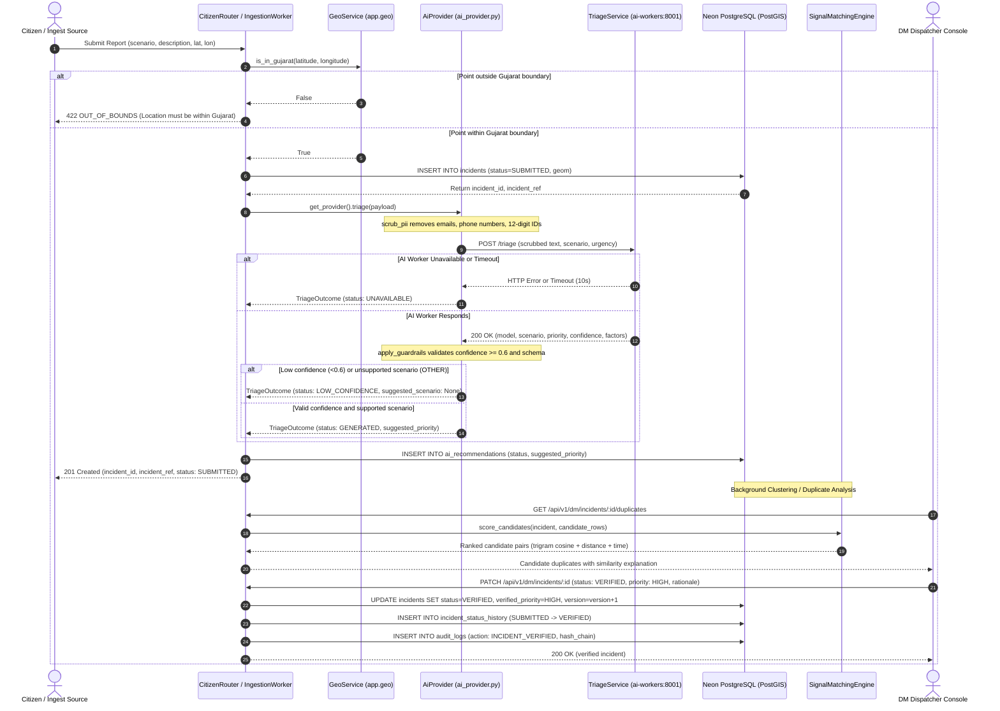
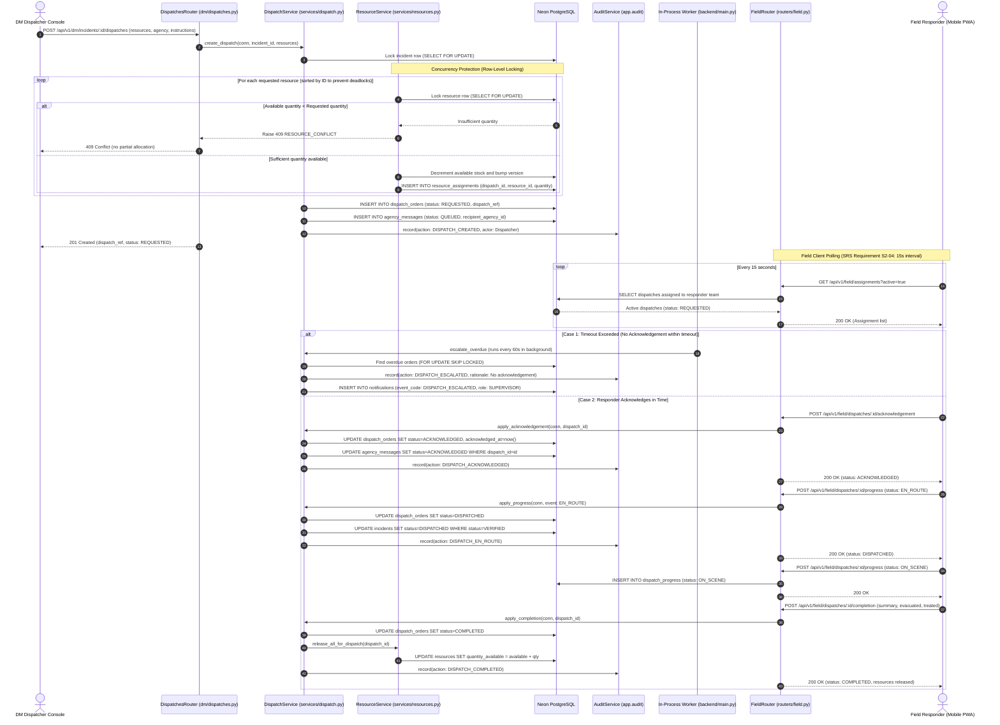
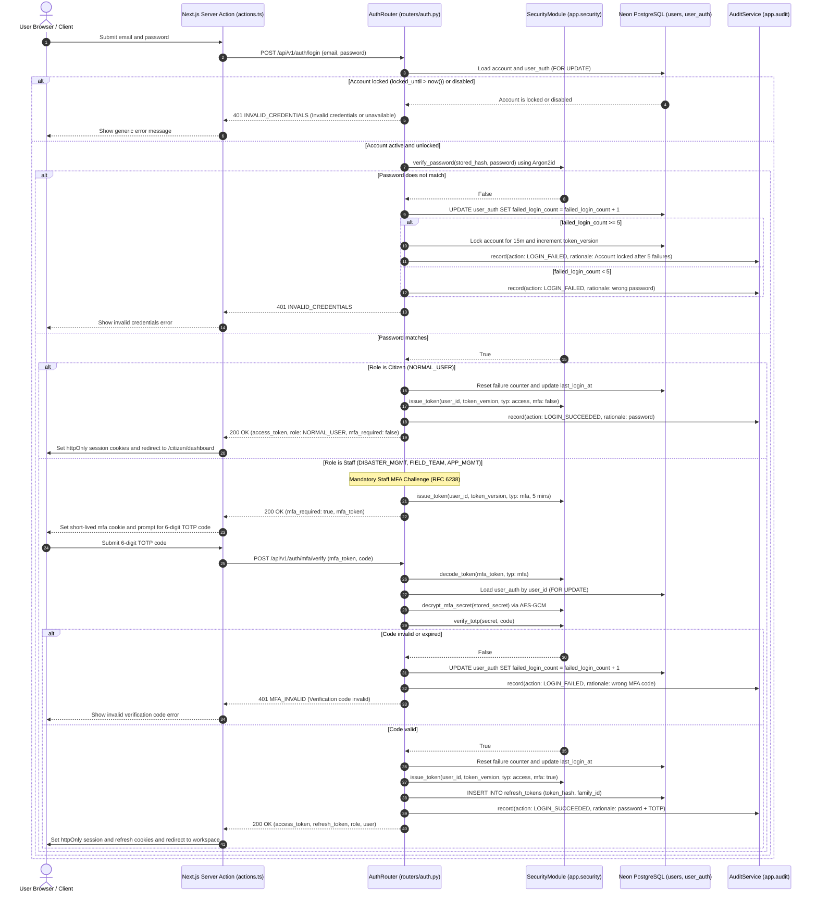
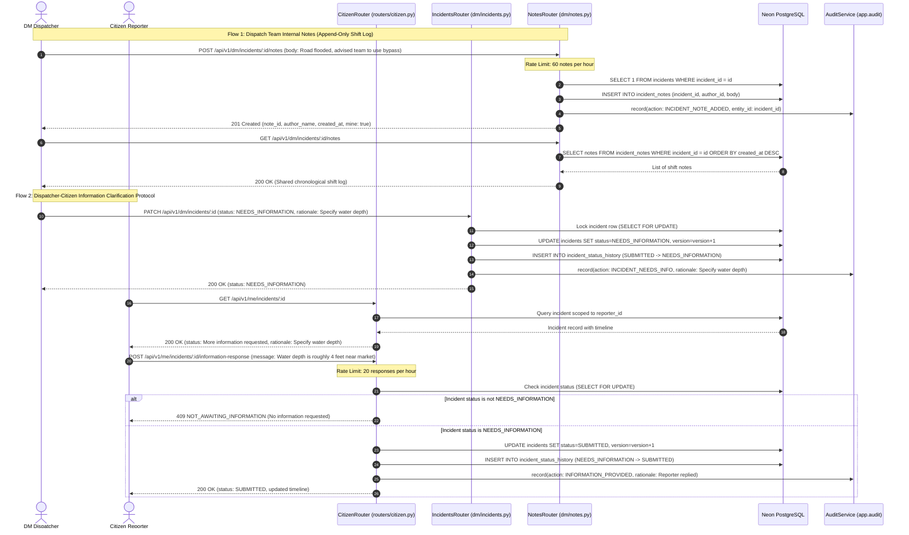

# DRCH Sequence Diagrams

This document details the dynamic runtime interactions of the Disaster Response Coordination Hub (DRCH) for the State of Gujarat. The sequence diagrams trace the exact execution paths across the Next.js frontend, FastAPI routing layer, PostgreSQL/PostGIS persistence engine, in-process background consumers, and the advisory AI microservice.

### Source files used
- [citizen.py](file:///c:/Users/Dhruv/.gemini/antigravity-ide/scratch/IT314_Software_Project/backend/app/routers/citizen.py) - Citizen report creation, location validation, and information-reply endpoints
- [internal.py](file:///c:/Users/Dhruv/.gemini/antigravity-ide/scratch/IT314_Software_Project/backend/app/routers/internal.py) - Ingestion execution endpoint protected by session advisory locks
- [incidents.py](file:///c:/Users/Dhruv/.gemini/antigravity-ide/scratch/IT314_Software_Project/backend/app/routers/dm/incidents.py) - Incident queue filtering, verification decisions, and closure
- [dispatches.py](file:///c:/Users/Dhruv/.gemini/antigravity-ide/scratch/IT314_Software_Project/backend/app/routers/dm/dispatches.py) - Dispatch order creation, idempotent submission, and resource allocation
- [notes.py](file:///c:/Users/Dhruv/.gemini/antigravity-ide/scratch/IT314_Software_Project/backend/app/routers/dm/notes.py) - Internal incident notes collaboration endpoint
- [field.py](file:///c:/Users/Dhruv/.gemini/antigravity-ide/scratch/IT314_Software_Project/backend/app/routers/field.py) - Field team mission polling, acknowledgement, progress, and completion
- [auth.py](file:///c:/Users/Dhruv/.gemini/antigravity-ide/scratch/IT314_Software_Project/backend/app/routers/auth.py) - Staff two-factor login, lockout counters, and citizen registration
- [security.py](file:///c:/Users/Dhruv/.gemini/antigravity-ide/scratch/IT314_Software_Project/backend/app/security.py) - Argon2id hashing, RFC 6238 TOTP verification, and AES-GCM encryption
- [ingestion.py](file:///c:/Users/Dhruv/.gemini/antigravity-ide/scratch/IT314_Software_Project/backend/app/services/ingestion.py) - Adapter execution, alert deduplication, and signal staging
- [ai_provider.py](file:///c:/Users/Dhruv/.gemini/antigravity-ide/scratch/IT314_Software_Project/backend/app/services/ai_provider.py) - PII redaction, confidence checks, and guardrails
- [signal_matching.py](file:///c:/Users/Dhruv/.gemini/antigravity-ide/scratch/IT314_Software_Project/backend/app/services/signal_matching.py) - Heuristic Jaccard and spatiotemporal signal clustering
- [duplicate_similarity.py](file:///c:/Users/Dhruv/.gemini/antigravity-ide/scratch/IT314_Software_Project/backend/app/services/duplicate_similarity.py) - Trigram cosine similarity for incident deduplication
- [dispatch.py](file:///c:/Users/Dhruv/.gemini/antigravity-ide/scratch/IT314_Software_Project/backend/app/services/dispatch.py) - Dispatch state transitions and automated background escalation
- [resources.py](file:///c:/Users/Dhruv/.gemini/antigravity-ide/scratch/IT314_Software_Project/backend/app/services/resources.py) - Atomic row-level inventory reservations (`SELECT ... FOR UPDATE`)
- [geo.py](file:///c:/Users/Dhruv/.gemini/antigravity-ide/scratch/IT314_Software_Project/backend/app/geo.py) - PostGIS Gujarat boundary containment checks
- [audit.py](file:///c:/Users/Dhruv/.gemini/antigravity-ide/scratch/IT314_Software_Project/backend/app/audit.py) - Append-only SHA-256 hash-chained event logger
- [triage_service.py](file:///c:/Users/Dhruv/.gemini/antigravity-ide/scratch/IT314_Software_Project/ai-workers/triage_service.py) - Advisory AI FastAPI microservice
- [main.py](file:///c:/Users/Dhruv/.gemini/antigravity-ide/scratch/IT314_Software_Project/backend/main.py) - Lifespan background workers (`ai_workers_background_consumer`, `ingestion_background_worker`)
- [actions.ts](file:///c:/Users/Dhruv/.gemini/antigravity-ide/scratch/IT314_Software_Project/frontend/src/app/login/actions.ts) - Next.js server actions handling login and MFA handshake
- [page.tsx](file:///c:/Users/Dhruv/.gemini/antigravity-ide/scratch/IT314_Software_Project/frontend/src/app/field/page.tsx) - Frontline responder tactical interface and 15s auto-refresh polling

---

## 1. Sequence (a): Report Ingestion, Triage, Clustering, & Priority Scoring

This sequence shows an incoming emergency report passing through PostGIS boundary validation, PII redaction, advisory AI triage scoring, heuristic spatiotemporal clustering, and human dispatcher verification.

This sequence captures the core ingestion pipeline. Coordinates are verified via PostGIS containment queries before database insertion. Before forwarding text to the advisory triage microservice (`ai-workers:8001`), the backend scrubs reporter PII. The model suggestion is validated by backend guardrails; confidence values below 0.6 or unsupported scenarios are flagged as `LOW_CONFIDENCE` and routed for manual inspection. A human dispatcher examines heuristic duplicate and related-signal scores before assigning an operational priority (`CRITICAL`, `HIGH`, `MEDIUM`, or `LOW`) and recording the verification in the audit trail.

---

## 2. Sequence (b): Dispatcher Assigns Unit & Field Team Lifecycle (HTTP Polling)

This sequence illustrates dispatch order creation, row-level concurrency locking on inventory resources, frontline field responder updates via 15-second polling, operational progress milestones, and automated escalation upon acknowledgement timeout.

This sequence models the dispatch transaction and unit coordination flow. When a dispatcher assigns a resource, the system locks inventory rows (`SELECT ... FOR UPDATE`) in deterministic order to prevent race conditions and deadlocks. The frontend field client polls the assignment endpoint every 15 seconds. If the team acknowledges within the timeout, they advance their deployment through `EN_ROUTE` and `ON_SCENE` milestones before submitting a mission completion report that automatically returns reserved resources to inventory. If an assignment remains unacknowledged, an in-process background consumer automatically triggers an escalation event, notifying supervisors without human intervention.

---

## 3. Sequence (c): Staff & Citizen Authentication Flow (Argon2id + TOTP MFA)

This sequence traces the authentication handshake for staff members requiring two-factor authentication versus citizens utilizing single-factor access, detailing failed attempt tracking, automated account lockouts, and cryptographic token issuance.

This sequence specifies user authentication. Citizen accounts authenticate with passwords and receive access tokens directly. Staff accounts enforce a two-stage verification: password validation via Argon2id followed by an RFC 6238 TOTP verification using an AES-GCM encrypted secret. The system tracks consecutive login failures; five failed attempts trigger an automated 15-minute account lockout and an increment to `token_version`, which immediately invalidates all active sessions. Successful authentication yields a signed JWT access token and a rotating refresh session stored in HTTP-only cookies.

---

## 4. Sequence (d): Incident Collaboration & Notes Log Flow

This sequence models the internal communication mechanisms within DRCH: (1) the append-only dispatcher incident notes log used for shift handovers, and (2) the asynchronous two-way information request and reply flow between dispatchers and citizens.

This sequence illustrates collaborative incident communication. Instead of unauthenticated free-text chat rooms, DRCH supports two formal, audit-logged mechanisms. First, dispatchers utilize `incident_notes` as an immutable shift log where notes cannot be edited or deleted, ensuring reliable handovers between disaster management shifts. Second, when additional field intelligence is required, dispatchers transition an incident to `NEEDS_INFORMATION`. The citizen receives the request on their report timeline and submits an `InformationReply` via `/information-response`, which automatically returns the incident to `SUBMITTED` for immediate re-evaluation.
